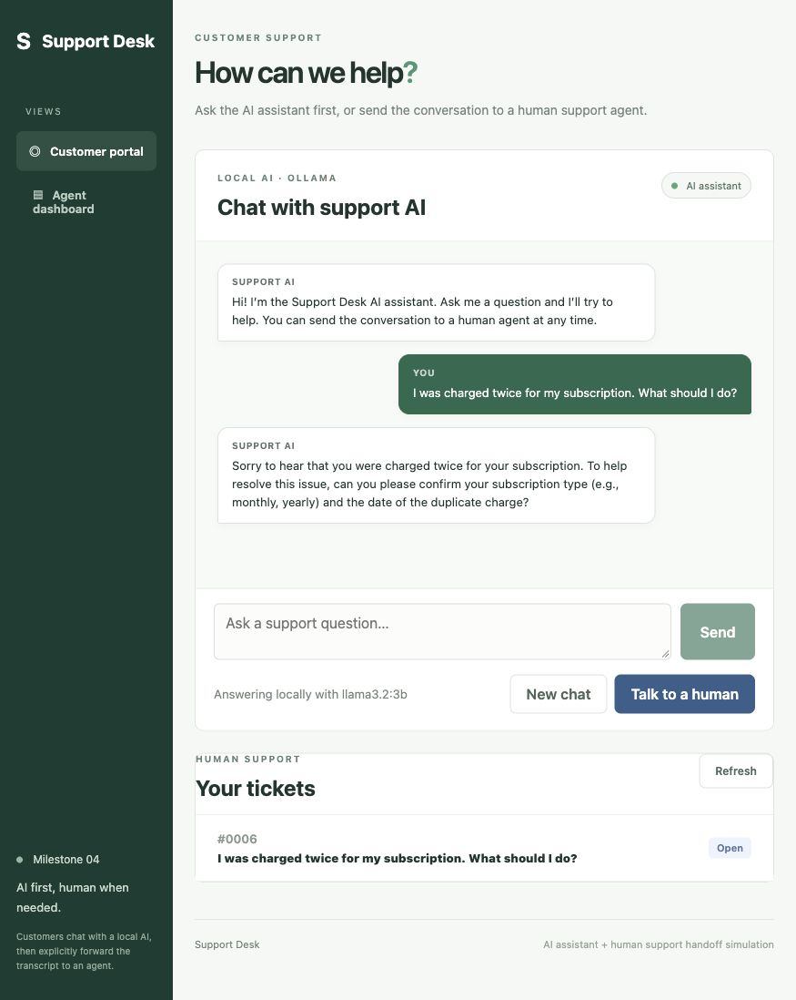
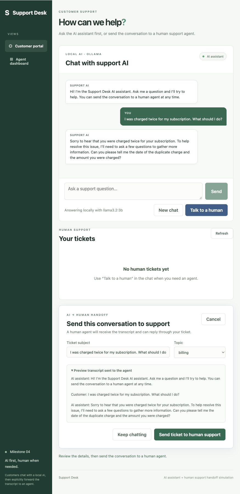
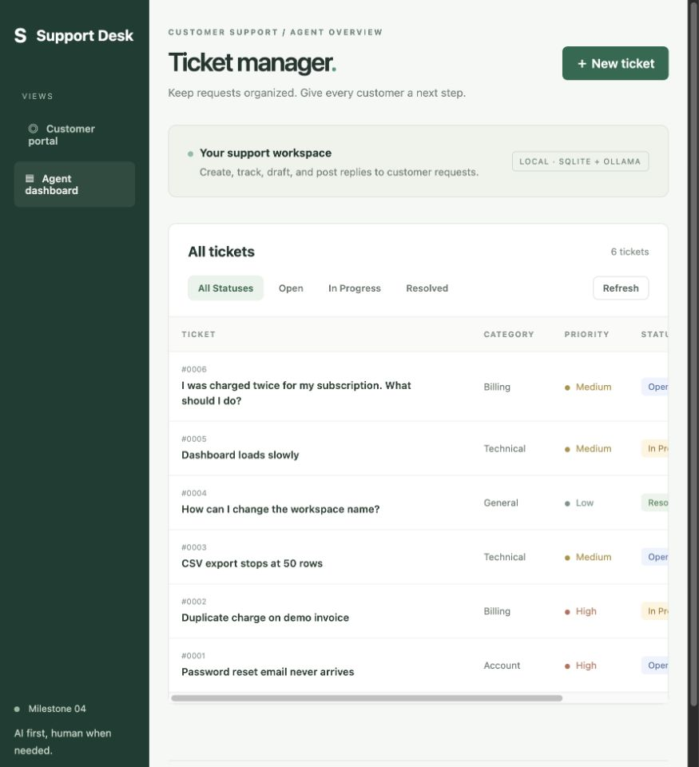
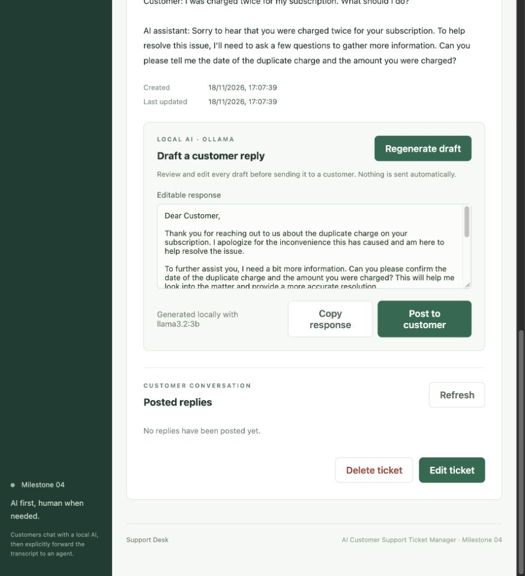

# Support Desk AI

### A human-centered customer support simulation powered by local AI

[](https://www.python.org/)
[](https://fastapi.tiangolo.com/)
[](https://react.dev/)
[](https://ollama.com/)
[](#quality)

Support Desk AI explores a practical question: **how can AI resolve simple customer questions without trapping customers when they need a real person?**

The application gives customers an AI-first support chat and a clear path to human help. If the AI is not enough, the customer can review the conversation and forward it as a ticket. A support agent receives the full context, can prepare an AI-assisted reply, and decides what is actually sent.

> The AI assists both sides, but people stay in control of escalation and communication.

## The experience

1. A customer asks the local AI assistant a support question.
2. The AI responds while remembering the conversation.
3. The customer can continue chatting or choose **Talk to a human**.
4. The conversation becomes a structured support ticket only after customer confirmation.
5. An agent sees the full transcript, ticket category, priority, and status.
6. The agent can generate and edit a reply draft before posting it.
7. The customer returns to the portal to read the human response.

## Product tour

### AI-first customer support

The customer gets immediate help from a local model, with a visible escape route to human support.



### A transparent human handoff

Before creating a ticket, the customer reviews exactly what will be forwarded and chooses the correct topic.



### A focused agent workspace

Agents receive new escalations alongside existing tickets and can filter work by status.



### Human-reviewed AI drafting

AI-generated replies remain editable and are never posted automatically.



## Why this project is different

- **AI does not become a dead end.** Customers can move to human support at any point.
- **The handoff keeps context.** The agent receives the complete AI/customer transcript instead of making the customer repeat everything.
- **Nothing is sent silently.** Customers approve ticket creation, and agents approve every outgoing reply.
- **It runs locally.** Ollama provides AI responses without paid API keys or per-message charges.
- **Both sides of the service are simulated.** The same application demonstrates the customer journey and the agent workflow.

## Highlights

- Conversational customer support with short-term context
- Explicit AI-to-human escalation
- Customer ticket tracking in the browser
- Agent ticket queue with status filters
- Editable AI reply drafts
- Persistent agent/customer messages
- Clear loading, empty, error, and confirmation states
- Responsive customer and agent interfaces

## Built with

| Area | Technology |
| --- | --- |
| Customer and agent interface | React, TypeScript, Vite |
| Application API | Python, FastAPI |
| Data storage | SQLite, SQLAlchemy |
| Local AI | Ollama with `llama3.2:3b` |
| Validation and testing | Pydantic, pytest |

## Run it locally

### Requirements

- Python 3.12 or newer
- Node.js 22 or newer
- [Ollama](https://ollama.com/download)

### 1. Download the local AI model

```bash
ollama pull llama3.2:3b
```

Keep the Ollama application open while using the project.

### 2. Start the backend

```bash
cd backend
python3 -m venv .venv
source .venv/bin/activate
python -m pip install -r requirements.txt
python -m app.seed
python -m uvicorn app.main:app --reload
```

Windows PowerShell activation:

```powershell
.\.venv\Scripts\Activate.ps1
```

### 3. Start the frontend

Open another terminal from the project root:

```bash
cd frontend
npm ci
npm run dev
```

Open [http://localhost:5173](http://localhost:5173).

## Try the full workflow

1. Ask the customer chatbot a question.
2. Select **Talk to a human**.
3. Review and submit the handoff.
4. Open **Agent dashboard** and select the new ticket.
5. Generate or write a reply, review it, and select **Post to customer**.
6. Return to **Customer portal** and refresh the ticket conversation.

## Quality

- **39 backend tests passing**
- TypeScript validation and production build passing
- Browser-tested customer chat → human handoff → agent response flow
- Automated tests use a fake AI response, keeping the test suite fast and repeatable

Run the checks:

```bash
cd backend
python -m pytest -q
```

```bash
cd frontend
npm run build
```

## Current scope

This is a local portfolio simulation. Customer ticket ownership is remembered in the browser rather than through real user accounts. It should not be exposed publicly with real customer data until authentication and authorization are added.

---

Built by **Malek Kalboussi** as a portfolio project focused on practical AI integration, thoughtful user experience, and human oversight.
